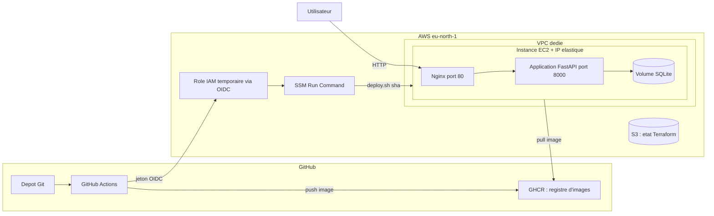
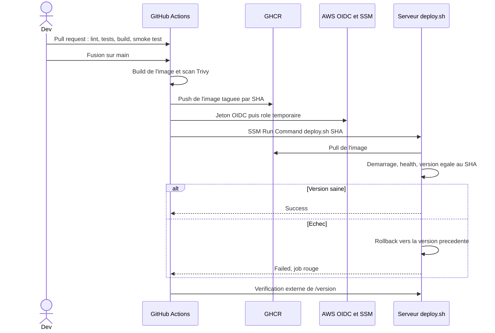

# Architecture

## Vue d'ensemble de l'infrastructure

## Chaine de deploiement

## Choix techniques

| Besoin | Choix | Raison |
|---|---|---|
| Cloud | AWS, region eu-north-1 | Compte disponible, profil cible du projet |
| Infrastructure | Terraform, etat dans S3 avec verrou | Reproductible, historise, verrou contre les ecritures concurrentes |
| Configuration | Ansible | Idempotent, installe Docker et l'application |
| Conteneurs | Docker multi-etapes, utilisateur non root | Image reduite, surface d'attaque limitee |
| CI/CD | GitHub Actions | Integre au depot, OIDC natif vers AWS |
| Acces du pipeline a AWS | OIDC + SSM Run Command | Aucune cle longue duree, aucun port SSH ouvert pour le deploiement |
| Images | Tag par SHA, jamais `latest` en production | Deploiement et retour arriere deterministes |

## Securite

- Role de deploiement limite a ce depot **et** a la branche `main` (sub OIDC immuable), droits SSM limites a l'instance.
- Scan Trivy bloquant (CRITICAL et HIGH) avant toute publication.
- Actions GitHub epinglees par SHA, mises a jour par Dependabot.
- Etat Terraform chiffre, versionne, sans acces public. Aucun secret dans le depot.

## Limites connues

- Indisponibilite d'environ 1 s par deploiement (recreation du conteneur) : un deploiement bleu/vert la supprimerait.
- Donnees SQLite stockees sur l'instance : perdues lors d'une reconstruction (volume EBS ou base geree en production).
- Ansible utilise SSH : necessite l'adresse IP de l'administrateur dans le groupe de securite (piloter Ansible par SSM l'eviterait).
- Etape Ansible dominante dans la reconstruction (87 s sur 159 s) : une AMI pre-construite la reduirait.
